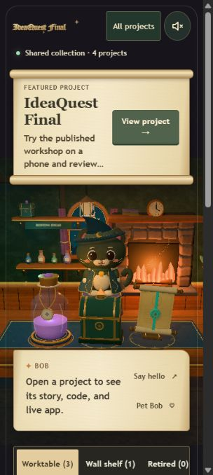

# IdeaQuest Final — professor review

**[Open IdeaQuest Final](https://idea-quest-ai101.vercel.app/)** · [GitHub source](https://github.com/mvvihaanmalik-create/ai101-p1-malik/tree/main/Obsidian%20Vault/AI%20101/Project%202/idea-quest-three-spike)

An interactive project collection in a cozy 3D workshop, with Bob the cat, project artifacts, visual progress, and project journals.

## Try it

1. Open **All projects** to browse or search the four recorded projects.
2. Open **Image Palette Studio** to see its last change, next step, visual milestones, live app, and source links.
3. Return to the room. Drag an artifact between the table and wall shelf, or use **Move or put away** in its journal. These arrangements are saved in the current browser.
4. Pet Bob, stoke the fire, or explore **Room extras**. Pause room motion if preferred; the focus countdown still works.

## What can be reviewed

- [Implementation, run instructions, and dated verification](idea-quest-three-spike/README.md)
- [Current project record and checkpoints](Workshop%20Projects/idea-quest.md)
- [Source modules](idea-quest-three-spike/src/)
- [Automated tests](idea-quest-three-spike/tests/)
- [Deployment manifest](idea-quest-three-spike/deployment-manifest.json)
- [AI use log](../ai-use-log.md)
- [Course workflow](00-start-here.md) · [approval record](progress.md)

## Scope and verification

The public site is read-only to visitors and does not access the owner's Windows vault. Project creation, vault discovery, checkpoint saves, and milestone editing work in the local workshop. A status-only monitor now publishes validated project summaries from the owner's running Windows computer; website design/code updates still require a separate release. The monitor is not yet configured to restart after reboot. No account or sign-in is needed to review the public site.

The October 13 performance update loads project controls before the room, reduces GPU work, caps render density, and suspends unnecessary animation. Fifteen automated tests passed. Browser checks covered desktop and 390px phone layouts, search, journals, links, pause mode, and the focus timer. Physical-phone frame rates remain unmeasured.

Class workflow approval is **3/5 for idea.quest** after Vihaan accepted the Step 3 prototype on October 13. The Human check and final decision remain open. The public site may still display the earlier published 2/5 snapshot until it is deliberately republished.
