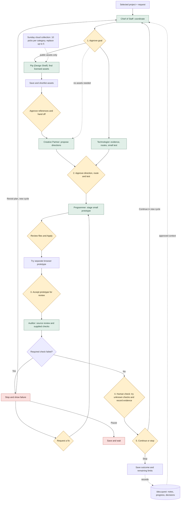

# Connected workflow

Updated October 27. [Open Workshop](https://ideaquest-workshop.vercel.app/) · [[process-map.canvas|Canvas]] · [[../Project-03/agent-status|Agent status and evidence]]

idea.quest stores project records and progress. Six agents share the selected project, voice, rules and IdeaQuest skill. Switching views never approves a gate.

## Approval and data rules

- Minor work can continue inside an approved step. Major choices need a concrete review point.
- Saving a card is not approving it. Creative Partner receives only the approved snapshot. A changed shortlist clears that approval.
- Reference approval and Apply are extra review actions within the five-step cycle, not extra progress points.
- Auditor supports technical review. The human-check step stays human. Unknown checks are never counted as passed.
- Failed checks pause progress until a requested fix or a reopened plan. Earlier results stay recorded.
- A changed project note needs a new review. Each project keeps its own cycle, drafts and conversations.
- Agents and project data use the PC. Sunday asset collection uses the cloud. Raw notes and passwords do not enter the cloud catalog.
- Original class gates do not approve a new Workshop cycle. Live progress comes from the selected cycle, not a number hardcoded in this diagram.

## Coursework progress

Part A's historical comparison is the Technologist run. Pip has its earlier controlled pair. Current comparisons for the other roles are new evidence, labelled with their limits in [[../Project-03/agent-status|agent-status]]. Part B is shared identity, voice, rules and skill across all six roles. Native Claudian observation, personal defense and submission remain separate from automated checks.
