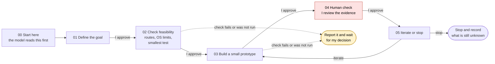

# Workflow diagram

The whole workflow on one page. The model reads `00-start-here.md` first, then works through the five step files in order. Every arrow waits for my approval. Step 4 is my own review of the evidence, so it is shown in red.

## How to read it

- Solid arrows are the normal path. Each one needs my approval before the next step starts.
- Dotted arrows are the rule from the start guide: if a check fails or has not been run, the model reports that and waits for me instead of moving on.
- Step 5 either loops back to a small build and review, or stops and writes down what remains untested.
- The same sequence is in `process-map.canvas`, which is the Obsidian version of this picture.
