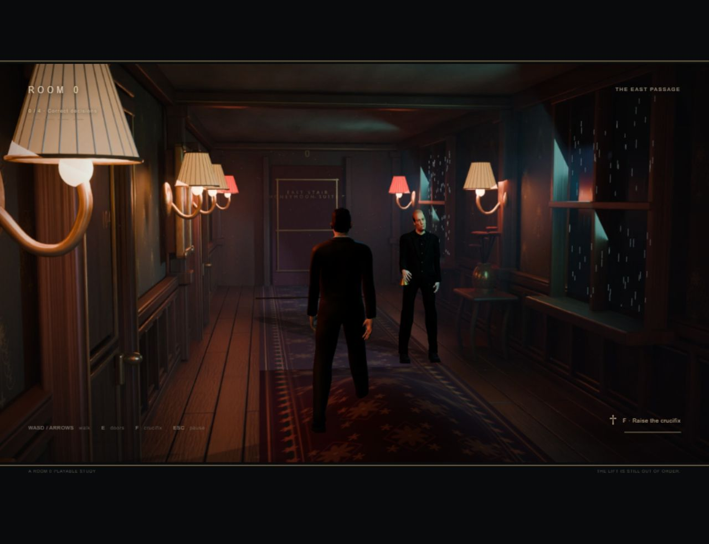

# Room 0: anomaly loop 04

November 8, 2026. Implementation authorized by Vihaan after the v3 environment pass. Local implementation and engineering verification completed; awaiting Vihaan's playtest.

## Implemented scope

- Unscored ordinary orientation, followed by independent 50/50 normal/anomalous passage draws.
- First playable pool: C1 floating bell with approaching butler, E2 upward rain at the middle window, E6 breathing carpet. All three landmarks have ordinary counterparts present during orientation and normal passages.
- A shuffled anomaly bag, with no repeats within a bag or immediately across its boundary. Progress resets preserve draw history. Restart creates a fresh run.
- Crossing the landing's double brass line submits turn back. Crossing the corridor's far brass line submits continue. Walking backwards or returning through the corridor door alone does not score.
- Four correct decisions in a row unlock the suite. Wrong decisions and butler contact reset to zero and return to the landing. A passage can resolve only once.
- The crucifix remains F, three seconds of repulsion, five seconds to recharge. C1's bell floats before the 2.5-second approach delay expires. The normal butler stands aside and does not pursue.
- Existing v3 rooms, closer cameras, lighting plates, rigged models and animation scheduler retained. The new rain and carpet are live geometry in the same world/camera space.

The other nine approved anomaly concepts remain pending character assets/effects. This is not a claim that the twelve-encounter catalogue or final reception ending is complete. The suite currently ends at an explicitly labelled build boundary.

## Verification

Seven Node rule tests pass: orientation, exact four-step unlock, wrong/contact resets, duplicate/stale decisions, threshold crossings, seed reproduction and 12,000 draws checking approximate frequency and no-repeat bags. See `tests/anomaly-loop-04/rules-tests.txt`.

Browser evidence is saved in `tests/anomaly-loop-04/`:

| Check | Observed result | Evidence |
|---|---|---|
| Full natural random run | Seed 3288141992 produced E2, E6, C1, E6 after ordinary orientation. Four real return-threshold crossings advanced 0, 1, 2, 3, 4; the stairs then reached the suite and its current stop panel. No review fixture was used for this run. | `01-natural-run-suite.json` |
| Normal continue | Crossing the far corridor line awarded exactly one point and entered the stairs. | `03-normal-continue.json` |
| Wrong continue | Continuing on E2 reset 1/4 to 0/4 and returned to the landing. Evading C1 and continuing also counted as wrong. | `04-wrong-continue-reset.json`, `07-wrong-butler-continue.json` |
| Crucifix and pause | Two F presses recorded one cast; repulsion 2.95 s and cooldown 4.95 s remained unchanged while paused, including held walking input. | `05-repel-paused.json`, `06-pause-input.json` |
| Contact | One butler contact changed 1/4 to 0/4, returned to landing and drew the next passage. | `08-contact-reset.json` |
| Held input | Holding W for 16 seconds crossed one continue line, scored once, and left the guest at the next stair entry. A fresh W press moved normally. | `09-held-input-one-score.json` |
| Wrong return | Returning from an ordinary corridor reset 1/4 to 0/4. | `10-wrong-return-reset.json` |
| Runtime assets | HTTP checks passed for modules, carpet texture, all nine plates, six rooms and both weighted 53-bone character rigs. Syntax checks and all seven rule tests passed. | `build/tools/check-assets.mjs`, `rules-tests.txt` |

The targeted branch checks use visible `?review` encounter fixtures to select a case, then actual keyboard movement and physical thresholds to exercise it. They do not replace the natural run. The full run preceded the final rain-spacing, normal-bell alignment and held-input corrections; those corrections were reloaded and checked in the later fixture runs. These are developer checks, not coursework human-test cycles or Vihaan's visual acceptance.

## Polish and performance

The final rain placement uses independent irregular positions, correcting an obvious diagonal pattern found in the first visual pass. The ordinary bell sits below the hand in world space. F works on a nearby C1 during the warning pause as well as pursuit. A double brass line marks each scoring boundary. Four restrained brass progress marks accompany the numeric count.

The E6 corridor submits 162,288 triangles and 54 draw calls, versus v3's measured 158,928 and 52. At a 1280×720 drawing buffer, a 60-frame completed-render probe measured median 0.6 ms and p95 1.1 ms. Live diagnostic samples ranged about 16.7–25.8 ms depending on the embedded browser scheduler. These are local measurements, not a promised frame rate on other computers. The visible-only timer fallback and hidden-tab pause remain intact.

## Remaining work

The three-cue pool needs a first human readability/difficulty playtest before the other nine concepts are added. Rain direction is a motion cue; a still screenshot cannot demonstrate its direction. The runner is live geometry over a baked plate, so its surface follows the guest but surrounding baked illumination does not respond to its deformation. Dedicated close-up inspection, per-tread stair foot placement, richer character vignettes and the approved final reception reveal remain future work. Nothing was publicly deployed.

## Source

`build/src/passage-loop.js` owns rules; `encounter-art.js` owns live cues; `main.js` connects physical movement, transitions, defense and HUD. No new runtime dependencies or external services. V3 runtime/configuration preserved in `sources/archive/visual-prototype-03/`.
