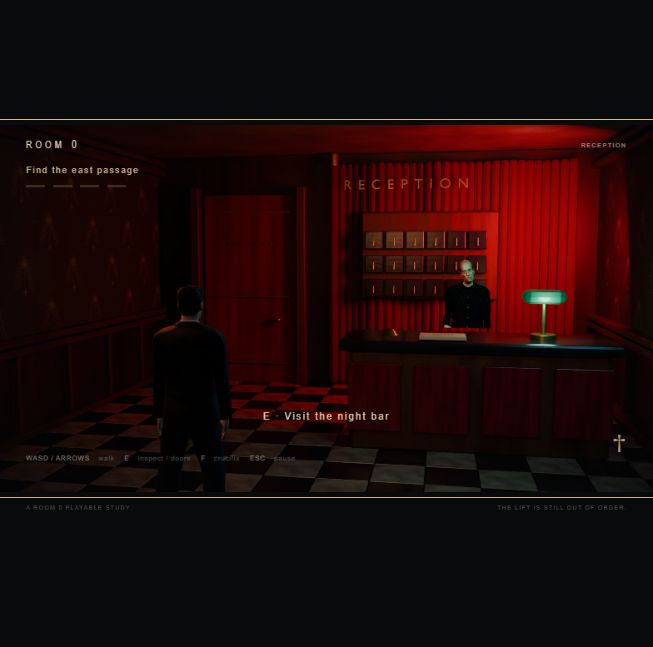

# Room 0: Vercel deployment 06

Historical first deployment. [Music build 07](music-07.md) supersedes its current build and soundtrack status; access protection remains enabled.

November 9, 2026. Vihaan requested deployment to Vercel while specifying that this is a private coursework build. Deployment is complete. The separate request to include Twin Peaks recordings remains pending source audio.

## Deployment result

- URL: https://room-zero-ashy.vercel.app/
- Immutable deployment: https://room-zero-ja87thhp9-vihaanmalik.vercel.app/
- Dashboard: https://vercel.com/vihaanmalik/room-zero/Bif1kvtszb27XoEZffjtxUxyaUWW
- Account/project: VihaanM / room-zero.
- Project ID: `prj_64GnsK6L4DVmoW0JYMDk9isLY6vZ`.
- Deployment ID: `dpl_Bif1kvtszb27XoEZffjtxUxyaUWW`.
- Status: READY. Target: production. Framework: static HTML/JavaScript, no build/install step. Build processing: approximately 2.4 seconds according to deployment timestamps.
- Commit: none; deployed from the local runtime package. File hashes provide source provenance.
- Protection: Vercel Authentication, `deploymentType: all`. Both the production alias and immutable URL return HTTP 302 to an unsigned request. Sign in with the owning Vercel account or another account that already has project access.

The CLI's first upload became the initial production deployment despite an explicit preview target. Default protection initially left the production alias accessible. Protection was immediately tightened to all URLs, and both URLs were checked again. No paid plan, custom domain, public share link or music purchase was activated.

## Packaging and verification

`build/tools/prepare-deploy.mjs` collects the runtime modules, vendor files/licences, explicitly referenced GLBs/texture/data, and camera plates listed in the two scene manifests. The runtime manifest contains 65 files totalling 30,016,407 bytes; configuration, a licence copy and the upload ignore file bring the deployed tree to 68 files. The upload excludes Blender source/backups, build tools/logs, node_modules, unused older assets, vault notes and local environment files. A noindex response header discourages indexing; Vercel Authentication supplies the actual access control.

- Eight runtime modules passed syntax checks; all 13 passage/ending tests passed before deployment.
- All 65 runtime files in the remote deployment matched the local files by SHA1. The deployed source tree contains no `.env`, `.blend`, `.log`, node_modules, build tools or `.vercel` directories.
- The hosted page completed asset loading and enabled Enter the hotel. Clicking it entered reception; walking, Escape pause and Return to reception worked.
- Browser warning/error review was empty. This was a hosted smoke check, not a repeat of the full random route and ending playthrough documented in [ending 06](ending-06.md).
- After tightening access, both unsigned URLs returned 302. An authenticated `vercel curl` retrieved the correct ending camera JSON. The CLI provisioned its normal project automation bypass credential internally; no credential was printed, committed or deployed.
- This is a static application with no server functions or database. No runtime monitoring service or log drain was added. Browser smoke checks do not establish cross-device performance.

Repackage from `build/` with `node tools/prepare-deploy.mjs`. The staging directory is `build/.deploy/room-zero-v6`; the hash manifest is `build/.deploy/manifest-v6.json`. That directory is linked to the exact project above. Verify the scope/project before future deploys and retain all-URL protection while the project is private.

## Twin Peaks music request

Suggested pairing for review: **The Fireman** for the hotel's suspended, melancholy atmosphere; **Dark Space Low** for the hostile reception ending. These are suggestions based on the desired contrast, not a claim that audio was auditioned in this session. Both appear on the [official Rhino soundtrack listing](https://www.rhino.com/product/twin-peaks-limited-event-series-original-soundtrack), which links to purchase/streaming services. [Presto Music also lists a digital download](https://www.prestomusic.com/classical/products/9540314--twin-peaks-limited-event-series-soundtrack).

No freely downloadable recording authorised for bundling was found, and no stream was extracted. No soundtrack purchase was made. The original synthesized game audio remains active. Actual integration awaits source audio supplied by Vihaan or another authorised source; it has not been represented as complete.
