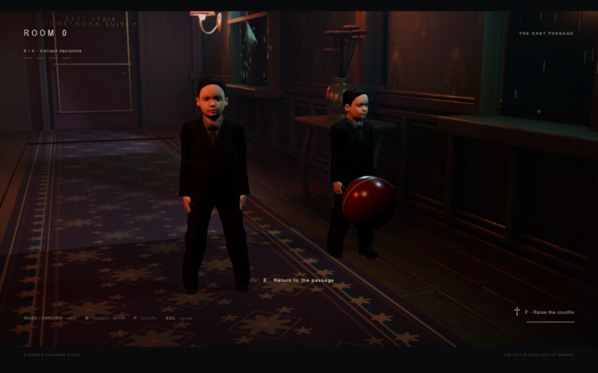

# Room 0: encounter expansion 05

**Later update:** The reception ending was implemented in [build 06](ending-06.md). Pending-ending statements below describe the v5 checkpoint.

November 8, 2026. Vihaan requested the remaining anomalies, polished normal counterparts, and ongoing vault updates. All twelve approved IDs now have implemented normal/anomalous versions. The local build is ready for his visual review. The hostile reception ending is still pending.

## What changed

The twelve-item shuffled bag replaces v4's three-item pool. The 50/50 ordinary/anomaly draw, no repeats until bag exhaustion, history across progress resets, unscored orientation, four-correct streak and suite gate remain. One character vignette appears at a time; an occupant's presence alone is never the answer. C1 remains the only pursuing threat.

| ID | Ordinary | Changed |
|---|---|---|
| C1 | Held bell, stationary butler | Floating bell, warning, approach |
| C2 | Closed cloche on silver trolley | Cloche levitates above the tray |
| C3 | Red ball rolls/bounces beside two children | Ball remains suspended |
| C4 | Standing dog and matching moving shadow | Dog stands; its shadow sits |
| C5 | Glass passes between staff hands | Released glass rises into a waiting hand |
| C6 | Guest's hand meets suitcase handle | Suitcase follows behind and to the side without contact |
| E1 | Founder portrait looks sideways | Frontal portrait plus escaped human silhouette |
| E2 | Downward window rain | Middle window's rain runs upward |
| E3 | Closed broken lift | Parted doors reveal continuous wallpaper |
| E4 | Static hallway mirror reflection | Impossible stair flight in the mirror |
| E5 | Empty coat hangs down | Coat extends horizontally from its stand |
| E6 | Flat runner | Runner breathes; walking height follows it |

Nine main views and eight matched inspection views now cover six locations. Detail views cover the general vignette, children, dog, portrait, mirror, coat, lift and rain. E opens/closes the nearby view. Walking stops but animations continue; Escape pauses both. The guest is hidden during inspection and returns to the same main view. C1 refuses inspection, including during the warning, to preserve a readable threat and retreat.

## Art and technical work

Added three weighted CC0-derived human assets: child, attendant and porter. The children use different sizes and suit tints; service staff use the new attendant and porter instead of repeating the guest. Each export has seven meshes, a 53-bone weighted rig and three authored clips. Source and additional young-skin license evidence are recorded in [character provenance](../sources/room-zero-character-assets.md).

Original dog sculptures provide standing and seated silhouettes, with articulated head movement. Its normal projected shadow follows its pose; the changed shadow uses the seated mesh. It is a procedural short-coated sculpture, not a fully skeletal or fur-simulated animal. The empty coat is adapted from the licensed fitted suit. The trolley, cloche, ball, suitcase, glass and cabinet are original runtime geometry.

Founder portraits are Blender renders of the adapted butler. The escaped shadow is a projected human mesh silhouette with the wall pattern retained. The mirror renders actual stair geometry visible to reflection rays only. Its normal view is a static rendered hallway, so it does not mirror the live guest. E4 also has a matching coat-view variant where that mirror is visible. This is the approved hybrid rendering approach, not real-time ray tracing.

The hotel export has 17 camera definitions and 28 matched 1920 x 1080 plates. The existing 1.18 camera/plate crop, output cap, local runtime, shadow budget and visible-only scheduler remain. Character shaders are prepared before entry; only the active vignette is shown and animated. E6 retains the ordinary side-standing butler to keep other figures off the deforming carpet.

Polish fixes made during verification: corrected depth writing on opaque imported materials; reset head rotation from its rest pose instead of accumulating rotation; shortened the glass handoff to reachable targets; aligned the correct luggage arm and grounded handle; moved detached luggage sideways so the separation is visible; widened and re-rendered the coat shot; clarified the founder silhouette and reflected stair; added warmer lift illumination in both versions.

## Verification and evidence

- `npm test`: 9/9 passed. Covers orientation, four-correct unlock, wrong/contact reset, once-only scoring, stale callbacks, 12-item bag exhaustion and boundary repeats, seed reproducibility, physical thresholds, all six ordinary vignettes and inspection hotspots.
- `npm run check`: all six runtime modules pass syntax checks.
- Local asset check: runtime dependencies, 28 plates, 17 cameras, six locations, all five weighted human exports and original prop nodes pass.
- Browser review: 24 ordinary/changed fixtures loaded with no recorded runtime errors. Saved states: [pair-checks.json](tests/encounters-05/pair-checks.json). Pair screenshots are developer fixtures, not evidence of a human playtest.
- Physical controls: E closed and reopened the lift inspection. Escape preserved simulation time exactly while paused. Closing inspection restored movement; C1 inspection stayed in the main view with `detail: null`.
- Physical route: E3 return, ordinary C3 continue, C4 return, ordinary C5 continue produced 1/4, 2/4, 3/4, 4/4. Walking upstairs and using E entered the suite. Fixtures selected the encounters but did not submit the decisions. [Route evidence](tests/encounters-05/route-checks.json).
- Continuing through C2 after three progress steps caused a wrong-choice reset to 0/4 and returned to the landing. [Reset evidence](tests/encounters-05/wrong-choice-reset.json).
- Glass contact: held phases sampled zero wrist/grip gap; near transfer, the two hands were 0.004 m apart at phase 3.64. [Contact samples](tests/encounters-05/C5-contact-samples.json). Luggage ordinary handle gap sampled 0 m; the final changed gap is 0.705 m. [Final luggage state](tests/encounters-05/C6-final-check.json).
- Rendering probe: two children plus the player, 276,992 submitted triangles, 66 draw calls, 60 completed samples, 1.0 ms median and 1.7 ms p95 at 1280 x 720. [Measurement](tests/encounters-05/performance-C3.json). This measures completed render cost, not sustained FPS. The embedded preview sometimes delayed frame callbacks; the existing visible-only watchdog remained active. Performance on other hardware is unmeasured.

Earlier v4 natural-random route, crucifix cooldown and contact evidence remains in [anomaly-loop-04.md](anomaly-loop-04.md). This pass did not replace human coursework Cycle 1/Cycle 2 testing, visual acceptance, audio listening or difficulty tuning.

## Preview

[Character pairs](tests/encounters-05/characters-pairs.jpg) and [environmental pairs](tests/encounters-05/environment-pairs.jpg) compare the authored baselines and changes. The current luggage screenshot is [C6.jpg](tests/encounters-05/C6.jpg).

## Sources and reproduction

Editable sources: `build/assets/hotel-v5.blend`, `child-v5.blend`, `staff-v5.blend`, `encounter-props-v5.blend`, plus retained v3 guest/butler and hotel foundation. Runtime: `src/encounter-catalogue.js`, `character-encounters.js`, `passage-loop.js`, `encounter-art.js`, `main.js` and review-only `benchmark.js`.

Regenerate with the documented v3 foundation, then run headless Blender on `build_child_v5.py`, `build_staff_v5.py`, `build_props_v5.py`, and `build_encounter_plates_v5.py`. The last script optionally accepts anomaly IDs or camera names after `--` for selective re-renders. Full runs regenerate all current variants. The retained archive and project-local MPFB tooling are required. Previous v4 runtime is preserved under `sources/archive/anomaly-loop-04/`.

No new online asset downloads, hosted services or publishing were used. Blender ran through its installed headless CLI; no Blender MCP invocation is claimed. MPFB tooling is GPL-3.0; selected graphical assets are CC0; the locally vendored Three.js runtime and added RoundedBoxGeometry utility are MIT.

## Remaining game work

The approved honeymoon-suite-to-reception reveal, repeated greeting, blur/darkness, glowing butler bones and surrounding cast still need implementation. Human review should assess cue readability, the dog's visual fidelity, glass choreography, sound and difficulty. The encounter expansion is complete; the whole game and coursework submission are not yet complete.
