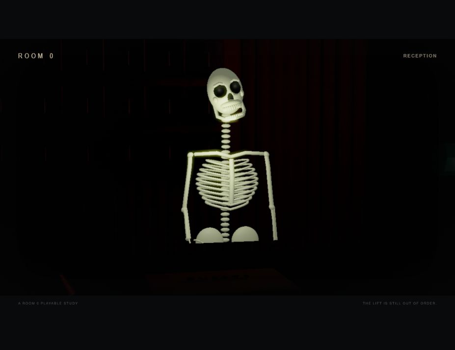
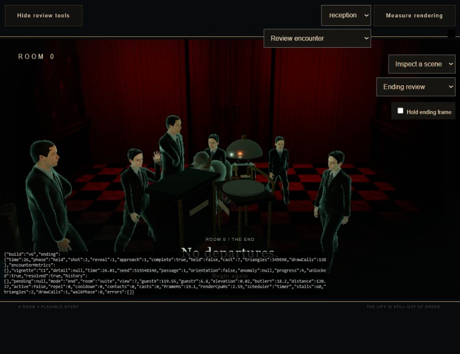

# Room 0: hostile reception ending 06

November 8, 2026. Vihaan requested the chosen hostile reception ending, the glowing butler skeleton and surrounding anomalies, with polish and vault updates. The ending is implemented and developer-verified. Human visual/audio acceptance remains separate.

## Result

Opening the suite after four correct decisions now returns to reception. The butler repeats **"We have been expecting you."**, using the same constant as the opening. The room darkens and the view blurs; his visible flesh and uniform disappear, revealing luminous skull, jaw, ribs, vertebrae and limb bones. A reverse shot reveals seven figures from all five other character encounters closing around the viewpoint: room service, both children, dog, server, bartender and luggage guest. Their familiar props remain. The game ends on this approach with **No departures.** and **Begin again**.

The ending is separate from a wrong-choice reset. Score remains four, no new passage is drawn, and no gameplay runs behind the sequence. The guest is outside the close/reverse frames, preserving the hidden-face direction. The butler remains in the preceding shot rather than being duplicated in the surrounding cast.

| Simulation time | Beat |
|---|---|
| 0-1.6 s | Suite threshold goes black |
| 1.6-6.2 s | Familiar reception; repeated greeting |
| 6.2-10.5 s | Close view, defocus/darkening and exposed bones |
| 10.5-13.8 s | Hold on the skull and rib cage |
| 13.8-14.5 s | Dark reverse cut |
| 14.5-24 s | Cast encloses the viewpoint |
| 24-26 s | Approach settles into the final image |
| After 26 s | Terminal frame; only explicit replay restarts |

Escape and window/tab interruption pause the same timeline. Walking, E and F cannot cast, score or move during the reveal. Replay restores ordinary reception, zero progress, unscored orientation, the original camera, HUD and controls. The pause text acknowledges the ending instead of giving irrelevant passage instructions.

## Assets and polish

The original stylized skeleton is a weighted 53-bone asset, about 3.07 MB, aligned to the existing CC0-derived butler rig. The skull has carved sockets and nasal cavity, an open jaw, separate teeth and narrower cheek arches. Bone geometry, not a glowing skin texture, forms the exposed figure. Dark cavity material preserves readable sockets. It is a procedural approximation, not a downloaded anatomical scan.

Two matched Blender shots extend the same reception geometry. The reverse view adds the previously unseen closed entrance and red curtains; it preserves the checkered floor and hotel materials. The existing gameplay plates are unchanged. The scene reuses the encounter cast, with material textures and restrained edge glow. Props have lower emission so a glowing trolley does not flatten the people into silhouettes. The cast placement and walking phase advance together. The dog keeps articulated head movement and group advance; it does not gain a new skeletal gait.

A dedicated render target supplies restrained glow, defocus and vignette. Reduced-motion preference disables defocus and the small bone-light pulse; there is no flashing strobe. Original synthesized bell/low-frequency cues accompany the shots. No recorded voice or downloaded soundtrack was added. The darkening, face texture, socket contrast, reverse framing, loading preparation and replay controls were refined after browser inspection.

## Verification

- **13/13 automated tests passed:** existing nine passage tests plus locked-suite/mode gating, exact greeting/order, finite terminal behavior, bounded/monotonic reveal and enclosure. [Rule results](tests/ending-06/rule-tests.txt).
- All eight runtime modules pass syntax checks. [Syntax results](tests/ending-06/syntax-check.txt).
- Asset checks validate the existing catalogue, five human rigs, 28 gameplay plates and the new weighted skeleton, two ending shots and dark cavity material. [Asset results](tests/ending-06/asset-check.txt).
- A review fixture placed the player at the unlocked suite. The actual **E** interaction started the ending. At 2.53 s the greeting matched the opening. Pause plus held walking input preserved the ending time, position, four-step progress and zero casts exactly. [Pause/input evidence](tests/ending-06/pause-and-input.json).
- Resuming progressed to fully exposed bones at 10.55 s, then to the enclosing cast and `mode: end` at 26 s. Walking/E/F did not exit that terminal image. [Door-to-ending evidence](tests/ending-06/door-to-ending.json).
- **Begin again** restored `playing`, `reception`, `progress: 0`, `orientation: true`, `ending: null`, with no errors; walking worked again. A review-only diagnostics overlay initially intercepted this button, so it now ignores pointer input. [Restart evidence](tests/ending-06/restart.json).
- The ending renderer, including its composite pass, measured **2.3 ms median / 5.8 ms p95** over 60 completed frames, at an 1111 x 625 drawing buffer. The cast scene submitted 349,598 triangles / 138 draw calls, plus a two-triangle composite. The benchmark's raw counters report the last composite pass; [scene counters](tests/ending-06/performance-scene.json) record the cast. [Completed-render measurement](tests/ending-06/performance.json).
- Browser console review reported no warnings/errors. Material variants and geometry are warmed before entry. Embedded-preview frame scheduling still varied; completed rendering cost is not a sustained FPS or other-hardware claim.

The browser test used the unlocked-suite fixture, not another natural-random run through the entire hotel. The v5 four-choice route and v4 natural-random/defense tests remain the preceding route evidence. This work does not complete human coursework test cycles, reflection or oral-defense preparation.

## Actual browser images

## Source and reproduction

Runtime: `build/src/ending-timeline.js`, `reception-ending.js`, integration in `main.js`, and review-only controls in `benchmark.js`. No new dependency. `character-encounters.js` exposes its existing actors for the ending choreography; the ordinary encounter behavior and randomization are unchanged.

Assets: `butler-skeleton-v6.glb`, `ending-butler-v6.webp`, `ending-surround-v6.webp`, and `ending-v6.json`. Editable sources: `ending-skeleton-v6.blend` and `ending-reception-v6.blend`. With the retained v3/v5 foundation, run headless Blender on `tools/build_ending_v6.py`. The two `refine_ending_*_v6.py` scripts regenerate only bones or the room. Completion markers were checked in the saved Blender logs.

No new online assets, service use or publishing occurred. Original bone/room/prop geometry and synthesized cues are project-authored. The reused human topology, rig and graphical assets remain CC0; MPFB tooling remains GPL-3.0; Three.js remains MIT. [Character provenance](../sources/room-zero-character-assets.md). Blender ran through the installed headless CLI; no Blender MCP invocation is claimed. Prior main/benchmark/style/index files are retained in `sources/archive/encounters-05/`.

## Remaining work outside this pass

Integrate the letter and fixed progress clues, review visual fidelity and sound/pacing with a human player, tune difficulty from that evidence, and complete the coursework records. The hostile ending itself is built; this is not a claim of final portfolio readiness or human acceptance.
