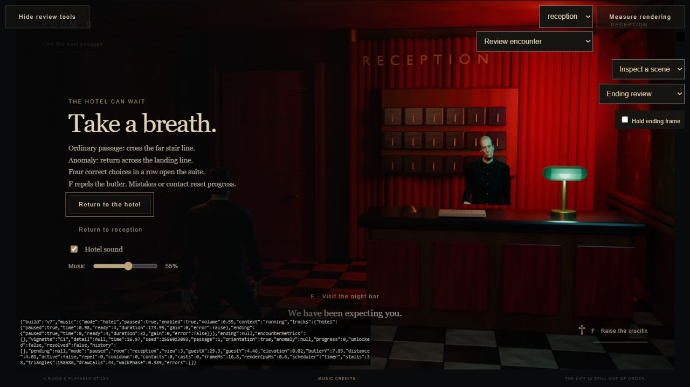

# Room 0: night music 07

November 9, 2026. Vihaan requested freely available music with a Twin Peaks-like atmosphere, an atmospheric hotel cue, a darker ending cue, and an update to Vercel. Implemented and deployed with all-URL Vercel Authentication retained.

## Music and provenance

Both tracks are by **Kevin MacLeod (incompetech.com)**, provided by the composer's site under **Creative Commons Attribution 4.0**. The choice pursues melancholy noir piano followed by unsettling sustained orchestral/synthetic texture. It does not use or reproduce Twin Peaks recordings.

| Role | Track and official source | Game adaptation |
|---|---|---|
| Hotel | [Night on the Docks – Piano, USUAN1100135](https://incompetech.com/music/royalty-free/index.html?isrc=USUAN1100135) | Approximately 174 seconds; level normalization, MP3 compression, edge fades, looped playback, soft low-pass filter |
| Ending | [Long Note Four, USUAN1100467](https://incompetech.com/music/royalty-free/index.html?isrc=USUAN1100467) | Opening 32-second excerpt; level normalization, MP3 compression, fades and a volume envelope following the 26-second ending |

[CC BY 4.0 licence](https://creativecommons.org/licenses/by/4.0/). Original files, the selected official catalogue metadata and the composer page containing the attribution template are retained under `sources/music-07/`. Downloads came directly from `incompetech.com/music/royalty-free/mp3-royaltyfree/`. No account, purchase or paid library was needed. The in-game footer opens `build/music-credits.html`, which gives artist, track/source links, licence links and adaptation details. No endorsement is implied.

## Playback

Music starts with Enter the hotel, not before a user gesture. Hotel sound controls both score and synthesized effects; a separate music slider adjusts only the score. The default is 55%. Existing footsteps, bells, ambience and threat cues remain.

Opening the unlocked suite fades the piano over 2.4 seconds while the darker cue enters. Its level rises through the skeleton reveal and surrounding cast, then fades to zero over seconds 24–26. Both recordings are stopped at the terminal image. Replay resets the ending track and restores the hotel cue. Escape and window/tab interruption pause playback without advancing it. The ending corrects substantial timing drift with guarded seeks; reduced rendering speed does not cause uncontrolled repeated seeks. Track load/playback errors leave gameplay and synthesized effects usable and display a small status message.

The MP3s add approximately 3.54 MB. Native media elements stream the files rather than decoding the entire long hotel track into a persistent Web Audio buffer. Music does not block 3D asset loading. `tools/serve.mjs` now supports byte ranges and audio MIME types for local media seeking; Vercel serves the static MP3s independently.

## Verification

- All nine runtime modules passed syntax checks; all **15 tests** passed, including score handoff, terminal silence, pause, mute, and replay behavior. [Tests](tests/music-07/tests.txt).
- Browser playback reported both tracks decoded (`readyState: 4`), correct durations, a running audio context, and advancing hotel time with a nonzero gain after Enter the hotel. The ending remained paused at zero.
- Keyboard volume adjustment and mute worked. Muted gameplay advanced the hotel track while its gain stayed at zero. Volume was restored to 55% afterward.
- A review fixture placed the player at the unlocked suite; actual E interaction triggered the ending. The piano stopped after the handoff and the darker cue advanced with the reveal.
- Pause held the ending audio at 10.02 seconds across the input test. Resume completed the visual timeline at 26 seconds; both tracks then reported paused with zero gain. Replay restored hotel playback and reset the ending track to zero. [Browser evidence](tests/music-07/playback.json).
- An initial local test exposed unreliable seeking without HTTP range responses. The preview server was corrected, and a repeated full ending/pause/replay test passed. A byte-range request returned 206 with the expected 100-byte response.
- No browser warnings/errors were observed after the fix. These are developer checks, not a claim of human listening approval or an additional natural-random full playthrough. Final subjective mix/pacing remains open to Vihaan's review.

## Deployment result

- Stable URL: https://room-zero-ashy.vercel.app/
- Immutable build: https://room-zero-d1sth2cyg-vihaanmalik.vercel.app/
- Deployment: `dpl_9A6QegMtccze2e6kiNjiMfeaXBZi`, **READY**, production, static HTML/JavaScript. Build processing approximately 2.4 seconds.
- Existing team/project: VihaanM / room-zero, `prj_64GnsK6L4DVmoW0JYMDk9isLY6vZ`.
- Source: local package, no Git commit. 72 files, approximately 33.57 MB of manifest-listed runtime content. `build/.deploy/manifest-current.json` records hashes; the staging directory retains its existing `room-zero-v6` name solely to preserve its Vercel project link.
- Authenticated requests to the stable URL returned both MP3s, new HTML and music credits. Their SHA256 hashes exactly matched local tested files. [Hosted verification](tests/music-07/hosted-hashes.json).
- An unsigned request to the stable URL still returned 302. Vercel sign-in protection was retained; no share link or public access exception was created.
- No server functions, database, log drain or monitoring service was added. Browser playback was checked locally; hosted asset bytes were checked through authenticated Vercel requests.

The packaging tool includes the two audio files and credits page, while excluding original source recordings, vault notes, Blender sources, tools, logs and local environment files.
