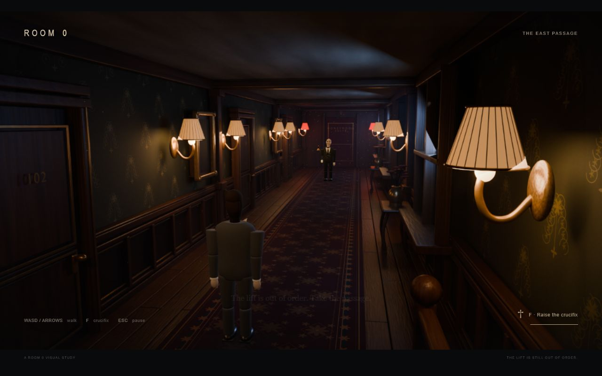
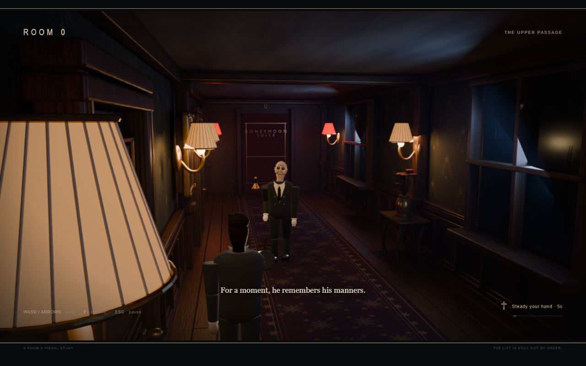

# Room 0: visual prototype 01

Date: November 8, 2026. Built and checked by Codex. Awaiting Vihaan's visual review.

## Scope delivered

An original Blender-rendered corridor, two matching fixed cameras, a moving 3D guest and butler, depth occlusion proxies, soft contact shadows, floating bell, crucifix repulsion/cooldown, contact return, pause/restart and synthesized sound. The runtime is served locally and all required Three.js files are bundled. See [README](../README.md) for controls and regeneration.

This is the authorized first visual/technical proof. It is not the finished game, a statement of moodboard parity, or the formal coursework Cycle 1/2 process.

## Visual evidence

These are actual browser screenshots at a 1280 × 800 desktop viewport. The game preserves its 16:9 camera/plate ratio inside that viewport. The preview was also inspected in the narrow default panel; the title layout was shortened to fit it. Desktop keyboard play remains the target.

## Engineering checks

Story under test: enter the local page, load the rendered environment and GLBs, walk into the butler encounter, cross cameras, repel and retreat, or be returned to the starting point on contact.

| Check | Observed result | Evidence |
|---|---|---|
| JavaScript parsing | `node --check src/main.js` passed | Local terminal check |
| Assets and camera contract | Fourteen required HTTP resources returned 200; two camera definitions matched the 16:9 render contract | `build/tools/check-assets.mjs` |
| Forward movement and cut | Guest reached corridor distance 12.04 m; camera became view 1 | [Encounter screenshot](tests/visual-prototype-01/02-butler-encounter.jpg), [state record](tests/visual-prototype-01/02-repulsion-and-cut.json) |
| Repulsion and cooldown | One F use caused repulsion. A second press during recharge did not increment casts. Butler retreated from 16.24 m to 18.43 m while the guest backed away | Same state record |
| Return cut | Guest retreated to 9.28 m and camera returned to view 0 | Same state record |
| Pause | A held W input while paused left both positions and timers unchanged | Same state record |
| Movement boundary and unknown key | Guest clamped at x = -1.37 and corridor distance 2.9 m. Q caused no movement or error | [Boundary record](tests/visual-prototype-01/03-boundary-and-input.json) |
| Contact return | One contact; guest returned to x = -0.32, distance 3.8 m, butler to 18.2 m, view 0, inactive threat | [Contact state](tests/visual-prototype-01/04-contact-reset.json), [screenshot](tests/visual-prototype-01/04-contact-reset.jpg) |
| Browser diagnostics | No captured error or warning messages in the final main-path check | State record |
| Local performance observation | Smoothed frame intervals around 16.7–18.1 ms during inspected interactions, roughly 145k submitted triangles | Diagnostics; this is a local observation, not a cross-device benchmark |

## Problems found and repaired during prototyping

1. The first environment render was too bright and even. Reduced fill, warm lamp energy, world light and exposure; retained cool window contrast. Saved the refined plates and source scene.
2. The guest's procedural cloth did not export its Blender color correctly. Replaced unsupported procedural links with explicit glTF-compatible material values.
3. Subdivision shortened limb ends and left visible joint gaps. Added close support loops to retain limb length while smoothing clothes. Characters still need substantial art refinement.
4. Smooth normals on capped cloth meshes produced inconsistent shading. Adjusted the garment topology and support surfaces.
5. The pause overlay was obscured by the contact blackout. Moved pause panels above the fade layer.
6. The refinement process initially fell back to a slow render-device configuration. Stopped that owned render and explicitly selected OptiX in the refinement script; final renders completed.
7. Added spatial limits to the repelled butler so it stays within the corridor, and limited guest movement near the consoles.
8. Included GLTFLoader's transitive SkeletonUtils dependency when bundling the local runtime. All required bundled paths passed the HTTP check.

## Honest visual assessment

The prototype establishes the warm/cold hotel palette, fixed-camera composition and working hybrid rendering pipeline. It does not yet reproduce the moodboard's realism. The characters remain visibly simplified, especially their anatomy, faces, joint transitions and fabric. Hotel wear and decorative detail are also simpler than the reference.

Shadow planes approximate contact, not physically correct character shadows; real-time character lighting and baked AgX lighting need further matching. The gait has no foot IK or captured animation. The screenshot is evidence of a working proof, not evidence that these remaining quality problems are solved.

## Not covered by these checks

Human listening assessment, other GPUs/browsers, mobile controls, complete stair geometry, full anomaly randomization, E inspection, four-step progression and the reception ending. The optional far-door end card was not exercised in the recorded browser run. Formal coursework cycles are untouched, and no public deployment was performed.
