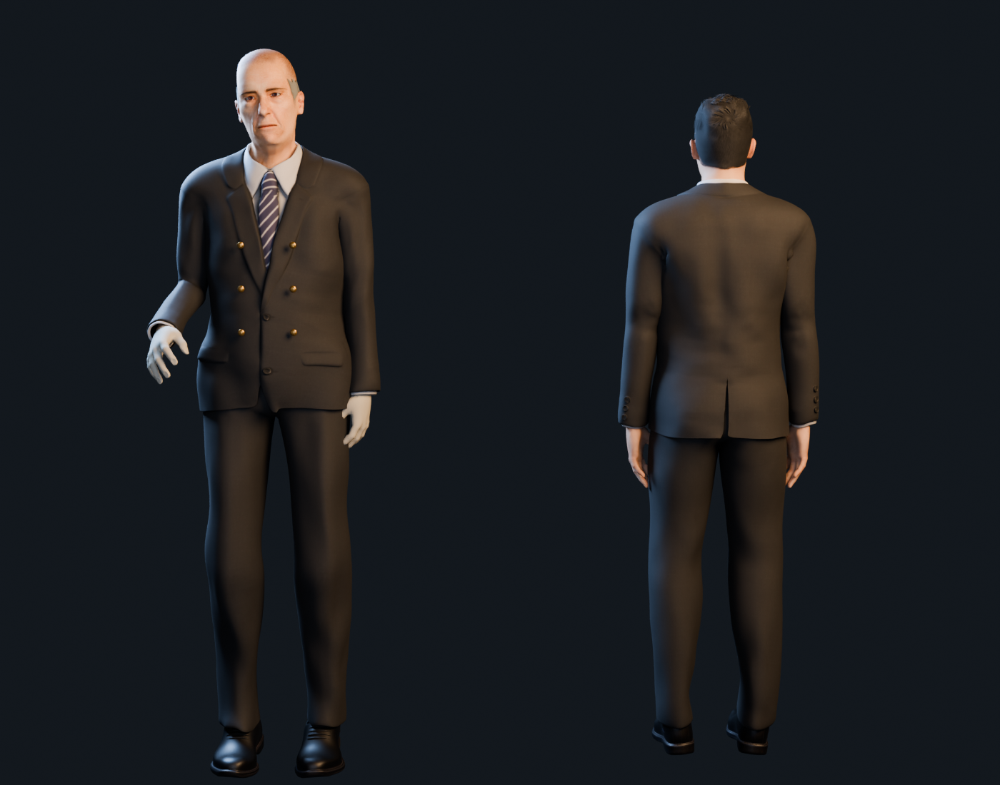
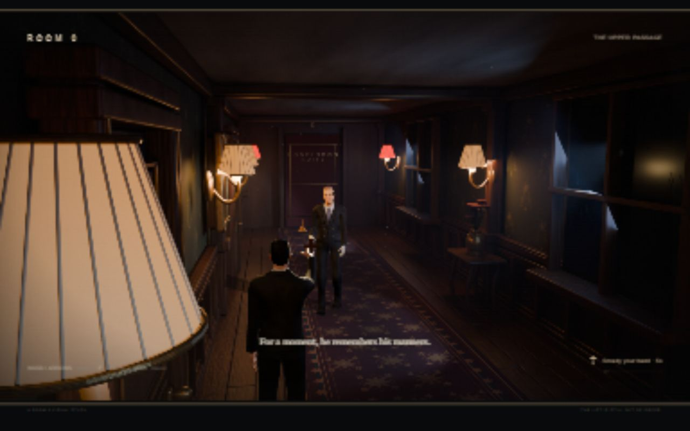

# Room 0: visual prototype 02

November 8, 2026. Implemented and checked by Codex after Vihaan rejected the first characters as too blocky. The new appearance awaits Vihaan's review.

## What changed

- Replaced both segmented prototype figures with CC0 MakeHuman humans, detailed skin and face components, fitted suits and formal shoes. Each has a weighted 53-bone rig and three authored clips: Idle, Walk and Raise.
- Distinguished the butler through older and gaunter proportions, a receding silver hairline, ivory gloves, brass buttons, a held head inclination and restrained movement. The guest remains back-facing in both gameplay cameras.
- Attached the crucifix to the guest's hand bone. Tuned walking cadence and reversed the walking clip during retreat. The independently floating bell remains the butler's anomaly cue.
- Corrected moonlight positions that were blocked by window mullions, adjusted warm/cool balance, added floor roughness variation, and rendered new 1920 × 1080 plates. Added a live floor shadow alongside the existing contact shadows.
- Embedded WebP textures limited to 2048 pixels: guest GLB 6.73 MB, butler GLB 6.28 MB. Hidden teeth and tongue meshes at runtime because both mouths remain closed in this study; their meshes remain in the editable source and GLBs.

The detailed source, credits and licensing are in [the character asset note](../sources/room-zero-character-assets.md). MPFB was executed through local headless Blender, not through Blender MCP. The original v1 files and evidence remain preserved.

## Visual evidence

Actual Blender render of the exported source characters, with the butler facing the camera and the guest facing away:

Actual browser encounter screenshot:

The studio lighting is deliberately more revealing than the game lighting so the anatomy, hair, clothing and shoes can be assessed. It is not a gameplay screenshot or a generated moodboard image.

## Engineering checks

| Check | Observed result | Evidence |
|---|---|---|
| JS syntax and local asset routes | Syntax passed; all 14 required routes returned HTTP 200; camera metadata has two matching 16:9 views | `node --check src/main.js`, `node tools/check-assets.mjs` |
| Rig and animation export | Guest: 9 meshes; butler: 15 meshes; each has one skin, 53 joints, vertex weights and Idle/Walk/Raise channels | `tools/check-assets.mjs` parses the actual GLBs |
| Advance and repel | Upper view reached at guest distance 12.12; F registered one cast and active repulsion; zero contacts/errors | `02-encounter.json`, `02-butler-encounter.jpg` |
| Retreat and cooldown | Returned to view 0 at distance 9.38; repeated F during cooldown did not add a cast | `03-retreat-pause.json` |
| Paused input | Positions, repulsion, cooldown and cast count unchanged while W was held during pause | `03-retreat-pause.json` |
| Contact reset | One contact returned guest to 3.8, view 0, inactive butler at 18.2 | `04-contact-reset.json`, matching screenshot |
| Browser errors | No errors or warnings in the checked console; in-page error list empty | JSON evidence and browser console inspection |

These are agent engineering checks. They do not fill formal coursework Cycle 1/2 tests or claim that Vihaan performed the tests.

## Performance and limits

The earlier active desktop runs reported approximately 29.7 to 33.7 ms per frame at a 1280 × 800 viewport, about 30 fps. After the runtime mouth-interior cull, submitted triangles fell from roughly 566k to 445k, including the shadow pass. Later browser observations became much slower, with saved evidence around 396 ms per frame and subsequent readings higher. The browser dimensions also changed during that sequence. The cause was not established. Treat performance as unresolved; do not claim a stable 30 or 60 fps result from these samples. `05-late-render-check.json/.jpg` records that later check, not a successful second encounter. No console error or failed asset load explained it.

The detailed figures are a large improvement over v1's primitives, but this pass does not claim photorealism, final moodboard parity or portfolio readiness. Facial performance, cloth simulation, final foot contact and fine gesture blending remain to be polished. There can still be a visual mismatch between realtime skin and the offline-rendered hotel. The live floor shadow is approximate. More material wear and set dressing remain useful future art work.

The full route, randomized anomaly loop, inspection close-ups, four-step progression and reception ending remain outside this visual study. The current far door still ends the study. The preview remains local at `http://127.0.0.1:4170/`; nothing has been published.
