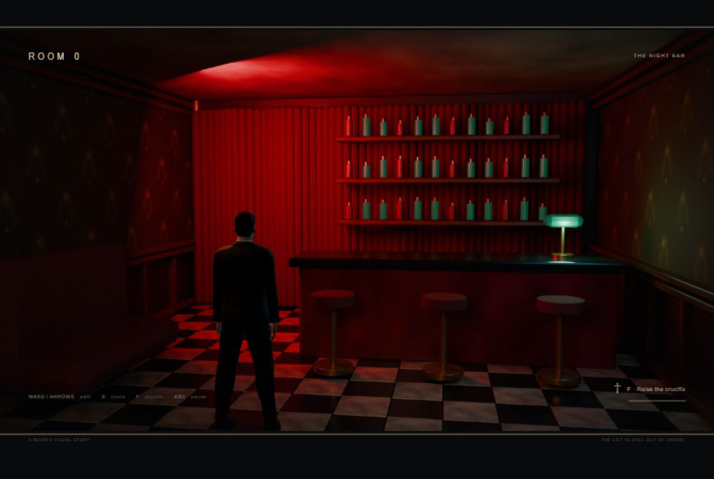
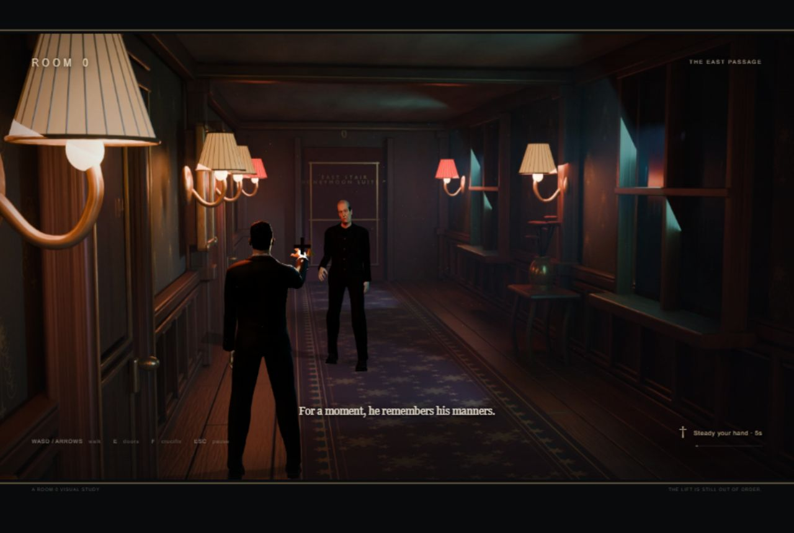
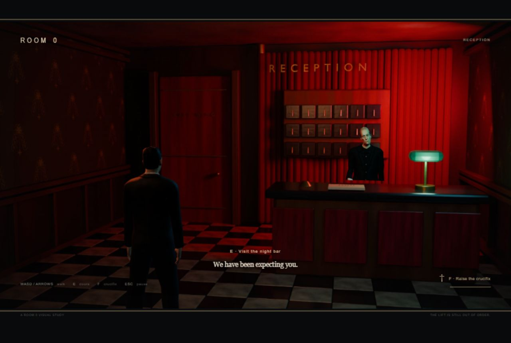
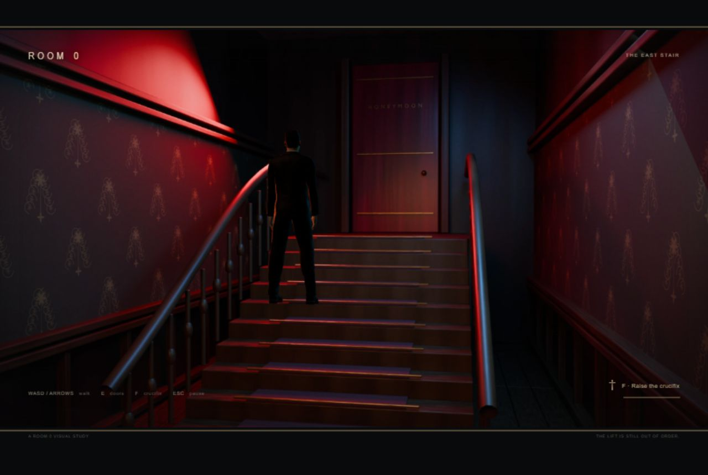

# Room 0: visual prototype 03

November 8, 2026. Vihaan accepted v2 as an improvement and requested performance fixes, better walking, a more unsettling butler, closer gameplay, stranger noir colors and the beginning of the remaining hotel spaces. This is the resulting implementation for review.

## Delivered

- Six connected places: reception, night bar, broken-lift landing, east passage, stairs and honeymoon-suite threshold. Nine authored Blender camera plates, with matching real-time geometry and room bounds. E operates transitions and notices.
- Closer camera positions/lenses, plus an identical 1.18× centered crop on each plate and perspective camera. The shared crop preserves depth registration and makes the characters more prominent without stretching the image.
- Crimson velvet, black-and-ivory marble, green banker lamps, cold blue-green window light and stronger red stair lighting. The existing walnut, brass and oxblood palette remains underneath.
- Butler refinements: darker formal uniform, central brass buttons, narrower skull, reduced cheek fullness, more open eyes, extended neck, held head inclination and restrained arm swing. The guest's face remains hidden.
- Distance-driven skeletal walking, reverse phase during retreat, blended idle/walk, heel/toe motion and an additive right-arm crucifix gesture. Both weighted 53-bone rigs remain editable.

## Performance diagnosis and fix

The old embedded preview sometimes reported a visible document but delivered animation frames about 745 to 817 ms apart. A 60-frame direct completion probe reported a much smaller cost, showing that scheduling delay and render work were different problems. This probe calls the renderer and `gl.finish()` synchronously; its quantized timings are a diagnostic, not an end-user FPS benchmark.

The visible-only watchdog now calls the same update/render function when requestAnimationFrame stalls beyond 100 ms. Hidden or blurred gameplay pauses. It does not simulate background time. Static/paused scenes avoid redundant draws. Shaders are compiled before entry; render resolution is capped. The runtime uses two local point lights instead of fifteen distributed ones, with a 512-pixel shadow map. Smooth base clothing/accessory meshes replace unnecessary subdivision while retaining the face/body detail.

| Measurement | V2 | V3 |
|---|---:|---:|
| Corridor submitted triangles, including shadow pass | 444,804 | 158,928 |
| Guest GLB | 6.73 MB | 2.93 MB |
| Butler GLB | 6.28 MB | 2.79 MB |
| Completed-frame probe median | 0.2 ms | 0.1 ms |
| Completed-frame probe p95 | 0.3 ms | 0.3 ms |

Live movement checks in the 1280 × 800 desktop viewport stabilized around 16.7 ms/frame, with some earlier timer-fallback samples around 19 to 24 ms. The guest travelled the expected distance under held input, unlike the earlier stalled run. This establishes improvement in this environment, not guaranteed 60 fps on every browser/device.

## Verification

- Syntax check passed. All runtime routes, nine plates and six room definitions passed the local HTTP asset check. Both GLBs contain 53-joint skins, vertex weights and Idle/Walk/Raise clips.
- Numerical gait check sampled the planted left ankle at 17 guest frames and 31 butler frames. After compensating for intended forward travel, drift and height variation rounded to 0.00000 metres. This checks the authored stance ankle, not every point on the shoe or individual stair contact. See `01-gait.json`.
- Browser checks covered repulsion at about 3.3 metres, return across the camera boundary, unchanged state under paused input, and lateral evasion past the butler.
- The route was traversed through real keyboard input and E transitions: reception, bar and return, landing, corridor, stairs, suite threshold. E at the suite displayed the study endpoint. The last gameplay state and route screenshots are saved below.
- No browser error or warning was observed in the checked console. Engineering checks were performed by Codex, not Vihaan, and do not fill formal coursework Cycle 1/2 tests.
- After the final camera crop, the live corridor check reported 17.7 ms/frame with working repulsion. A subsequent contact returned the guest to corridor distance 4.1, with one contact and an inactive butler. See `16-final-close-corridor.json`, `17-contact-reset.json` and `18-final-console.json`.

Evidence lives in [tests/visual-prototype-03](tests/visual-prototype-03). Important files: `00-v2-baseline.json`, `01-gait.json`, `02-encounter.json`, `03-retreat.json`, `04-paused-input.json`, `05-v3-benchmark.json`, `06-stair-traversal.json`, and `15-route-complete.json`. Final closer-framing screenshots are also saved there.

## Scope and remaining work

These are traversable environment foundations. More set dressing, wear, portraits, localized audio and character-specific staging remain. The stair collision follows a smooth slope over the rendered steps; dedicated stair animation and foot placement remain. Facial performance, cloth simulation and exact moodboard parity are not claimed.

The twelve-anomaly randomization, four-correct-decision scoring, full inspection close-ups, remaining characters and hostile glowing-skeleton reception ending are not implemented by this pass. The suite endpoint is a temporary environment-study stop, not a replacement ending. The opening line, “We have been expecting you,” is a working implementation line for review, not an approved final screenplay.

Sources and reproduction: [README](../README.md), [technical approach](../room-zero-technical-approach.md), [character asset provenance](../sources/room-zero-character-assets.md). V2 runtime sources were backed up under `sources/archive/visual-prototype-02/`. Nothing was deployed publicly.
