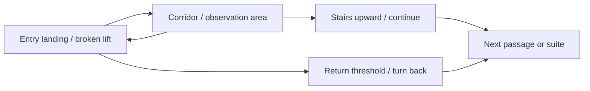

# Room 0: route, camera and controls

**Placement:** Give people a place in the hotel: the children can share a landing, the server and bartender can share the bar, and the traveller can wait by the luggage room. Save the full gathering for the reception ending.

**Luggage room, v16.** After the second correct decision, compare the ticket with the stamp in the mirror. Select with A/D and turn or claim with E. A mismatch lets you retry. A match opens the staff stair. Solving it once is enough for that run.

**Current route, v15 (November 10):** After the unscored gallery tour and first climb, each landing offers E at the register for the east stair, or W through the red door for the west gallery. On an observation flight, cross the bottom step to return or top step to continue. In the gallery, use the entrance and far end. A transfer flight is safe and unscored. Four correct decisions unlock the suite. Escape pauses and opens the ordinary register; E inspects/closes. No combat or holy item. [Decision and staging](decisions/ADR-010-separate-the-ascent.md). Older entries below document earlier versions.

**Current override, November 9 (v11):** Vihaan approved removing the crucifix. Retreat is the defense; contact still resets progress. C2 now knocks beneath a closed cloche, C3 removes one child while the ball returns, and C6 separates the guest from his reflection. This supersedes the historical defense and encounter descriptions below. [Implementation and evidence](build-record/atmosphere-11.md).

## Current build update: November 9, v9

Vihaan requested a stronger Exit 8 observation loop while retaining the Twin Peaks aesthetic, plus restrained Hokum influence and a full polish playthrough. The implemented ordinary floor now keeps the whole cast in fixed places. Random draws change one cue; turning back scores at the corridor entrance, and four correct decisions open the final stairs. Movement directions remain consistent through camera cuts. Suite bindings, candles, salt and a knocking cue add folk horror. [Implementation and full playthrough evidence](build-record/playthrough-09.md). This current update supersedes older implementation-status paragraphs below; it does not claim Vihaan has reviewed the new build or completed coursework testing.

**Status:** Route and controls approved by Vihaan on November 6, 2026. Visual Study 02 and the approved gameplay loop are the starting points. Rendering technology remains undecided; exact placement and movement feel will be checked in the prototype.

## Current implementation: anomaly loop 04

November 8: the approved thresholds and four-decision streak are implemented. The landing return line is at route coordinate 3.25 m; the far corridor line is at 21.9 m. Double brass inlays and nearby text mark them. An ordinary, unscored orientation comes first. After a choice, transitions clear held movement and require release, preventing carried input from crossing another threshold. The existing E door interactions connect the physical floor section. A correct fourth return also leads to the final stair and suite. Wrong choices and threat contact return to the landing at zero.

See [v4 engineering evidence](build-record/anomaly-loop-04.md). Detail inspection views, the remaining encounters, final reception reveal and individual stair-tread foot placement are still pending. The historical v3 update below records the state before this implementation.

## Approved route

**Previous implementation update, November 8 (v3):** Prototype 03 now connects reception, a night-bar detour, the broken-lift landing, the east passage, a traversable stair flight and the suite threshold. E opens nearby transitions and reads brief notices. There are nine fixed shots, with closer lenses/compositions and a matched 1.18× crop on the background and 3D camera. This is an environment route study; the four-decision anomaly scoring and final reception reveal remain unbuilt. The suite threshold currently ends the study. See [v3 evidence](build-record/visual-prototype-03.md).

Reuse one detailed hotel floor section: a landing beside the broken lift, a short corridor containing the encounter area, and a short stair flight. A sign points toward the honeymoon suite above.

- The player starts inside the entry landing, beyond the return threshold. Moving around or changing direction does not itself submit a choice.
- Crossing the marked return threshold submits **turn back**. Reaching the stair transition submits **continue**.
- After either choice, the approved normal/anomaly rule updates progress. The next passage reuses the floor section with another encounter state.
- Four correct decisions lead to the honeymoon-suite door. The approved hostile reception reveal is documented in room-zero-story-draft.md and remains unbuilt.
- For the hallway fallback, replace the short stair flight with a door to the next passage; retain the observation and decision layout.

## Camera direction

| View | Framing | Purpose |
|---|---|---|
| 1: Landing | High rear three-quarter view across the broken lift, entry and stair rail; face concealed | Establish the route and show the blazer silhouette. |
| 2: Corridor | Fixed view down the corridor with the figure seen from behind or cropped; see the far encounter area clearly | Inspect familiar landmarks and changes without losing the return route. |
| 3: Stair approach | Fixed side/rear view of the short stair flight; face outside frame or obscured by framing | Give the continue transition a distinct visual identity. |
| Detail view | A stationary close-up of an inspectable object; the guest is outside the frame | Show a portrait, sign or other clue; return to the same camera when closed. |

Switch between the fixed main views at defined spatial boundaries. Keep the active threat in view during its approach so a camera cut does not hide information the player needs. Body-only framing can show the shirt and tie; never reveal the face. Camera shot positions must be checked in the prototype.

## Approved desktop controls

| Input | Action |
|---|---|
| WASD or arrow keys | Walk through the scene. |
| E | Inspect a nearby object or close its detail view. |
| F | Raise the holy item when available. |
| Escape | Pause and show controls. |

Movement is relative to the current view. Holding a direction through a camera cut should preserve the movement direction until the key is released, avoiding a sudden reversal. The precise feel is subject to a prototype check.

## Fairness and prototype checks

- Allow the player to see an ordinary passage before the randomized sequence begins; this orientation passage is proposed as unscored.
- Present the passage's normal or anomalous state before the player reaches a decision threshold. Avoid introducing a new anomaly after a correct decision has been submitted.
- The return and continue thresholds must be distinguishable from ordinary walking areas. Crossing either submits one choice, once.
- Check a forward and a return traversal, the three camera cuts, one detail close-up, and a threat retreat before expanding the encounter pool.
- Check that the face stays hidden and the key anomaly cues remain visible from the inspection route.

These are planned checks, not completed tests. Desktop keyboard controls are approved. Exact dimensions, movement speed, camera locations, UI treatment and implementation approach remain open.

## Implemented route and inspection, November 8: encounters 05

The six-location v3 route and nine main shots remain. Eight additional matched detail shots cover the general guest vignette, children, dog, portrait, mirror, coat, lift and rain. E at a nearby hotspot opens inspection; E again restores the previous main view and guest. Movement stops during inspection, while encounter animation continues. Escape pauses both. C1 blocks inspection and asks the player to keep watching him; it cannot be suspended by a close-up.

The browser check verified actual E close/reopen, frozen time while paused, walking after close, return scoring through the lift landing and four mixed correct choices opening the suite route. Main camera movement continuity and transition key-release guards remain. The ending is still pending. See [v5 evidence](build-record/encounters-05.md).

## Ending 06 controls

E at the suite door requires four correct decisions and starts the concluding reception sequence. It cannot trigger from a locked suite or another room. WASD/E/F do not move, score or cast during it. Escape pauses/resumes the same moment; tab/window interruption also pauses. The reverse shot is automatic and hides the guest's face. The final image remains until **Begin again**, which restores reception, orientation and zero progress. [Browser evidence](build-record/ending-06.md).
