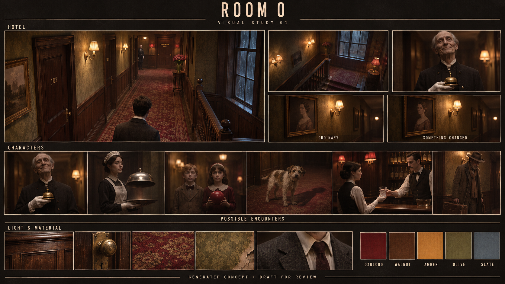

# Room 0: visual study 01

**Status:** Generated concept for Vihaan's review, November 5, 2026. This board proposes a visual direction; it does not settle the game's rendering style or character designs.

## Direction explored

- An aging hotel landing and short staircase, composed from fixed viewpoints.
- Walnut paneling, worn oxblood carpet, faded olive wallpaper, and tarnished brass.
- Warm amber practical lamps contrasted with cold slate-blue window light.
- A hidden-face guest in a shirt, tie, and blazer, and possible hotel encounters from the cast draft.
- A cinematic, textured visual treatment with restrained uncanny changes.

## Generation record

Generated with Codex's built-in image generation tool. The prompt synthesized the named inspirations: The Exit 8 for observation, Hokum and Twin Peaks for hotel atmosphere, Resident Evil for composition, Silent Hill for environmental unease, and Dune (1984) for small ceremonial costume influences. No source images were supplied to the tool; the board is newly generated concept art rather than a collage of screenshots.

The depicted characters, material palette, and rendering treatment are proposed. Image quality and animation feasibility in the actual game have not been demonstrated by this board.
