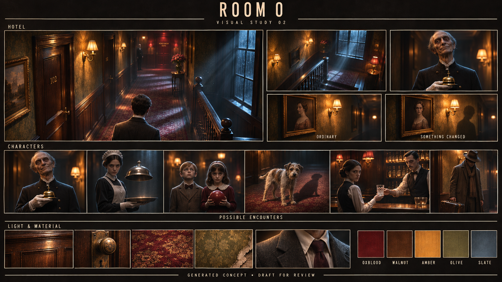

# Room 0: visual study 02

**Status:** Chosen by Vihaan as Room 0's visual direction on November 5, 2026. Study 02 develops study 01 with more unsettling characters and more beautiful lighting. It is the visual reference for the build; gameplay behavior and technical implementation are recorded separately.

## Changes explored

- Cooler window light and visible shafts across the landing, with richer amber pools from wall lamps.
- Stronger contrast, deeper shadows, atmospheric haze, and highlights on brass, wood, and fabric.
- A more uncanny butler, fixed character gazes, a floating cloche lid, and an unnatural dog shadow.
- A clearer normal-versus-anomaly portrait comparison.

Generated by editing study 01 with Codex's built-in image generation tool. Study 01 remains available beside this version. Both are concept artwork; the game's rendering and animation quality have not yet been demonstrated.
